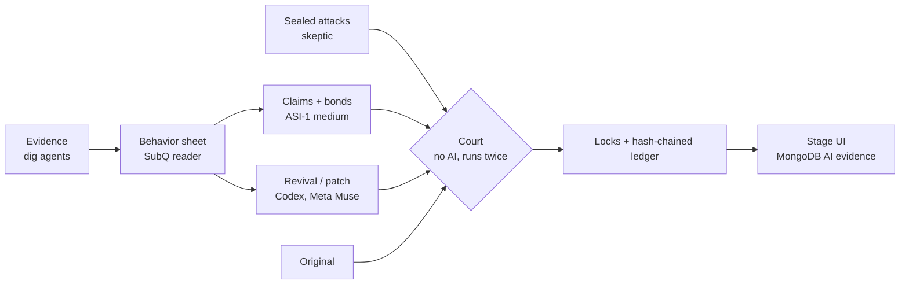

# MUSÉANCE

**A fidelity court for resurrected software.** AI proposes, the court decides. Built at the AIE Code Summit Hackathon, 2026-11-07.

AI can rebuild a dead app or patch legacy software fast, but nobody can prove the result behaves like the original. MUSÉANCE puts the rebuild on trial: agents gather evidence, an AI swears how the original behaved with credits on the line, and a court with no AI in it checks every claim on both builds. Only what survives is locked into the record.

## How it comes together



| Step | What happens | Where |
| --- | --- | --- |
| Evidence | Pages, issues, screenshots about the app, tiered A–D | `dig/` |
| Behavior sheet | What the app did, each line marked seen or guessed | `dig/` |
| Claims | The medium swears each behavior with a test, a confidence and a bond | `agents/` |
| Attacks | The skeptic writes tests without seeing the claims; they are hashed before claims are revealed | `eval/` |
| Revival | A builder rebuilds the app from the sheet only, never the original code | `revive/` |
| Court | Runs every test on original and revival, twice; same output = match, unstable = unsworn | `court/` |
| Record | LOCKED / STRUCK (perjury) per claim, every event in a hash-chained ledger | `runs/<app>/` |
| Stage | Both apps side by side, one test at a time: SAME or DIFFERENT | `court/ui/` |

## The cases we ran

**Cold Room Court (main demo).** A modeled supermarket cold-room controller, inspired by the Oct/Nov 2026 EU refrigeration attacks. *Modeled controller, not vendor code.* The legacy build accepts unauthenticated writes; the patched build adds three lines (`PATCH.diff`). The court talks Modbus TCP instead of a browser:
- 6/6 control behaviors (cooling, hysteresis, high-temp alarm, defrost) identical and locked, 0 flaky.
- 3/3 unauthorized configuration changes accepted by the legacy build, rejected by the patch, which keeps the room at its 4 °C setpoint.
- Ledger: 24 events, chain intact.

**Todo (2016, themaxsandelin/todo).** A real abandoned app, rebuilt from evidence:
- 121 checks (16 claims + 105 sealed attacks). Fidelity 41 → 100 after repair; differences 71 → 0.
- 15 of 16 claims locked; 1 perjury (the medium swore empty tasks could be added; it lost its 198-credit bond).
- 0 false strikes on 12 known-good behaviors. Codex and Meta Muse repaired it independently to the same verdict.

**Calculator (`app1`).** A hand-written practice case used to test the pipeline.

All numbers are measured from committed run files: `cases/METRICS.md`, `cases/BEFORE_AFTER.md`, `court/ics/sample_run/`.

## What the judges see

The stage (`court/ui/`) shows the original and the revival as two live apps. Press **N** (or *Run the next test*): the same steps play in both, the court's verdict lands (SAME / DIFFERENT), and the AI's claim is marked true or perjury. *Test it yourself* records your clicks in the original and asks the court live. MongoDB's AI (voyage-3.5 embeddings) shows the evidence closest to each claim. Fetch.ai agents argue the case in ASI:One (`agents/mesh/`).

## Run it

```sh
cd court/ui && npm ci && npm run seed -- todo      # committed todo results into runs/
node server/feed.ts                                 # stage feed (MONGODB_AI_API_KEY optional)
npm run dev                                         # open http://localhost:5173/?source=runs&app=todo
```

The full demo, including the cold-room controllers and the live court, is in `DEMO.md`. Lanes and rules: `AGENTS.md`; data contracts: `CONTRACTS.md`; credits and licenses: `CREDITS.md`.

| Folder | What |
| --- | --- |
| `court/` | The court, Bailiff locks, ledger, Modbus bench |
| `dig/`, `agents/` | Evidence, reader, medium, Fetch agents |
| `revive/`, `eval/`, `cases/` | Builders, skeptic, scoring, case files |
| `court/ui/` | Stage UI |
| `apps/` | The original apps (oracles) |
